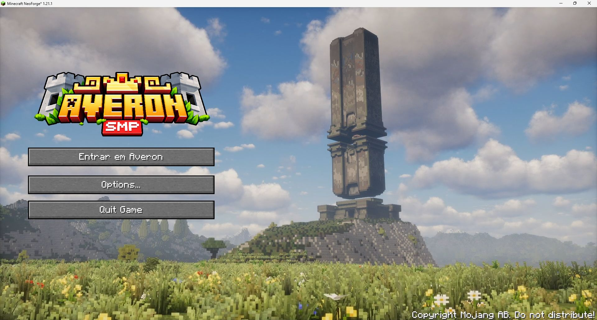

# Menu do Minecraft desde a primeira abertura

O launcher prepara o menu AVERON antes de iniciar o Java, inclusive em uma instalação nova que ainda não conectou ao servidor. O perfil de origem foi `ModrinthApp/profiles/Dev`, fornecido pelo responsável pelo servidor.

Inclui FancyMenu 3.9.14, Konkrete 1.9.9, Melody 1.0.10, Drippy Loading Screen 3.1.5 com seu early-window provider e WaterMedia 3.0.0.23 com Binaries 3.0.0.6. São as versões NeoForge do perfil para Minecraft 1.21.1. Esses arquivos são exclusivos do cliente; nenhum foi instalado no servidor Minecraft.

O manifesto incorporado em `assets/menu-bootstrap-manifest.json` fixa as URLs HTTPS, tamanhos e SHA256 de cada arquivo. O download inicial é de aproximadamente 201 MiB, com cache e retomada. O vídeo original de 1,59 GB foi convertido integralmente para H.264 em 1080p/30 fps, com 44,93 segundos e cerca de 32 MB. O áudio foi omitido porque o layout já o deixava mudo. Imagens, logo, botões e posições do menu foram mantidos.

Configurações e layouts existentes não são sobrescritos. Novos arquivos são instalados apenas quando ausentes, e configurações de teclado, vídeo, nickname e mundos não são importadas do perfil Dev. Dados pessoais do FancyMenu, histórico, mundos, bancos de variáveis e estado do editor não são distribuídos. Os caminhos dos recursos são relativos à pasta do jogo. A tela de boas-vindas do FancyMenu já está desativada no preset de origem.

Os arquivos de menu ficam em `game/config/fancymenu`, e o preset da tela de carregamento em `game/config/drippyloadingscreen`. O provider de carregamento é ajustado somente na primeira preparação, mantendo as outras opções de `fml.toml` e um provider diferente que o jogador já tenha escolhido. Recursos de exemplo inexistentes do preset Drippy foram substituídos pela logo e fundo reais.

Antes de abrir o jogo, o launcher conclui a transação pendente do AutoModpack. Se o AutoModpack passar a entregar algum desses mods, a cópia idêntica instalada pelo launcher na pasta `mods` é retirada para evitar duplicação; arquivos diferentes são preservados e a abertura é bloqueada com uma mensagem. A projeção e o registro de propriedade do AutoModpack não são editados. O recibo `menu-defaults-installed.json` registra os JARs instalados pelo launcher.

Uma segunda preparação completa foi testada com downloads desativados e não fez requisições. A instância isolada chegou à tela principal personalizada sem entrar em servidor, e o WaterMedia confirmou a reprodução H.264 com aceleração por hardware. A validação não incluiu uma sessão de jogo no servidor.

## Atualizar o preset

Publique os novos arquivos com nomes derivados do SHA256 e atualize o manifesto no código, mantendo os endereços anteriores disponíveis para launchers antigos. Em seguida, gere e publique uma nova versão do launcher. Esta primeira integração instala padrões quando ausentes; não força a substituição de layouts ou preferências que os jogadores já tenham editado.
