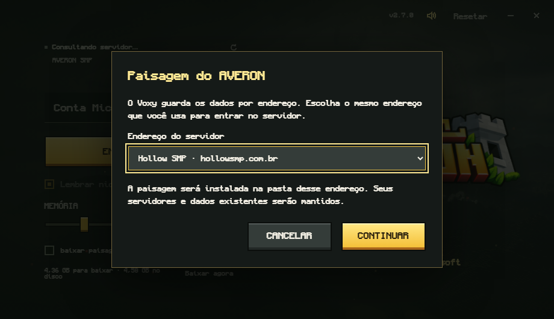

# Paisagem do Voxy

O download opcional prepara o LOD do Voxy fornecido pelo responsável do AVERON, substituindo a antiga opção do Distant Horizons.

O arquivo `hollowsmp.com.br.zip` tem **4.355.124.433 bytes** (4,36 GB) e contém **107 arquivos**, com **4.577.446.674 bytes** depois da extração (4,58 GB). Mantenha cerca de **9,20 GB livres temporariamente**: o download com retomada monta o ZIP antes de extrair o banco. O ZIP baixado pelo launcher é removido depois da instalação.

SHA-256: `2d505c515a933a8276c464606553c43548d332b7ec3c6500b90661964c4aa770`.

## Pasta e endereço

A versão instalada (`voxy-1.0.0-iris.jar`) usa `%LOCALAPPDATA%\HollowSMP\game\.voxy\saves\<endereço>`. Esse caminho foi conferido no próprio mod. Dentro dele ficam `config.json` e as pastas `<identificador da dimensão>/storage`, contendo CURRENT, MANIFEST, SST e WAL do RocksDB.

O endereço define a pasta, independentemente do nome em Multijogador. `hollowsmp.com.br` usa a pasta de mesmo nome; `hollowsmp.com.br:25565` usa `hollowsmp.com.br_25565`.

O menu FancyMenu conecta pelo endereço sem porta explícita. Se houver também um cadastro com `:25565`, o launcher oferece a escolha antes do download. Escolha a forma que você usa para entrar. A escolha fica em `voxy-landscape-installed.json` e é reaproveitada depois.

## Instalação e retomada

- Feche completamente o Minecraft. O RocksDB pode manter arquivos abertos mesmo depois de sair do mundo.
- O download usa até quatro intervalos HTTP simultâneos, retomando partes após interrupções.
- O ZIP e cada arquivo extraído são conferidos por SHA-256. A leitura em fluxo suporta ZIP64 sem carregar 4,36 GB na RAM.
- A instalação usa uma pasta de preparação. Um cache anterior desse endereço é movido inteiro para `landscape-backups/voxy`; dois bancos não são misturados.
- Uma transação interrompida é concluída na tentativa seguinte. Se a troca falhar, o cache anterior volta ao lugar. Uma preparação incompleta pode ser reparada com os dados já baixados.

O Voxy modifica e compacta seus arquivos durante o jogo. Por isso, depois da instalação, o launcher usa o recibo, o marcador de origem e os metadados do banco para reutilizar o cache; não exige que ele continue idêntico ao ZIP original. Isso evita baixar tudo a cada abertura.

O reset preserva a pasta `.voxy`, o recibo e os backups do Voxy. Dados de outros servidores e o cache legado do Distant Horizons também são preservados.

## Manifesto e manutenção

O manifesto versionado está em `assets/voxy-landscape-manifest.json`. O ZIP fica fora do executável, hospedado por HTTPS com nome baseado no hash. Para preparar outro snapshot, execute `python scripts/prepare-voxy-landscape.py <arquivo.zip> assets/voxy-landscape-manifest.json`, publique o ZIP no endereço imutável indicado e gere uma nova versão do launcher. Não substitua bytes de um ZIP já publicado sob o mesmo hash.

## Verificação

O arquivo completo foi instalado em uma instância isolada com o heap do Node limitado a 128 MB. A segunda instalação não baixou novamente. Os dois bancos foram abertos somente para leitura com RocksDB 10.2.1, a biblioteca usada pelo mod instalado, e passaram por `verifyChecksum()`.

Testes automatizados cobrem endereços, hashes, ZIP inseguro, links, cache existente, compactação, reset, jogo aberto, transações e rollback. A exibição no cliente conectado depende do endereço e dos identificadores de dimensão corresponderem ao mundo do snapshot.
